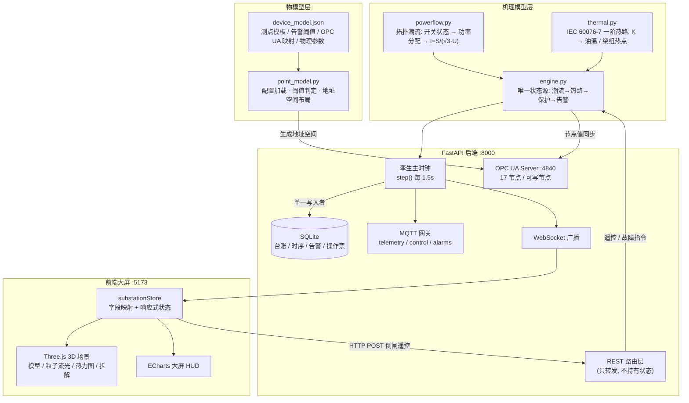

# 220kV 智能变电站数字孪生系统 (Smart Substation Digital Twin)

一个面向电气工程行业的 Web 3D 数字孪生原型：**Three.js 三维场景 + Vue 3 工业大屏 + 物模型驱动的遥测体系 + IEC 60076-7 机理模型 + OPC UA / MQTT 工业链路**。

不只是"能动的 3D 大屏"——设备电流、油温、负载率、健康度、告警全部由**物理模型算出来**，
断路器分合闸会真实改变拓扑潮流、设备负载与温度，故障注入是改变模型边界条件后让模型自己演化出后果。

```
分闸母联  →  II 段母线失电 → 负荷转移 → trans-1 负载率 76.1% → 151.9% → 温度按热路模型爬升 → 越限告警
```

---

## 目录

- [核心特性](#核心特性)
- [技术栈](#技术栈)
- [系统架构](#系统架构)
- [快速开始](#快速开始)
- [目录结构](#目录结构)
- [接口清单](#接口清单)
- [物模型：加设备不用改代码](#物模型加设备不用改代码)
- [机理模型：数据是算出来的](#机理模型数据是算出来的)
- [测试](#测试)
- [数字孪生成熟度说明](#数字孪生成熟度说明)
- [环境变量](#环境变量)
- [文档索引](#文档索引)
- [已知限制与路线图](#已知限制与路线图)

---

## 核心特性

### 三维可视化与交互
- **程序化建模**：主变压器（油箱/套管/油枕/散热器组/内部绕组铁芯）、GIS 组合电器、门型架构与母线，全部用 Three.js 几何体构建，零外部模型资产、秒开、可离线
- **动态视觉特效**：电流粒子流光（`BufferGeometry` + `Points`）、红外热成像着色器、告警脉冲扩散环、UnrealBloom 工业辉光
- **交互联动**：Raycaster 射线拾取 + TWEEN 平滑运镜，视角切换 / 自动巡航 / 部件爆炸拆解
- **Blender 资产通道**：内置 `GLTFLoader` + `DRACOLoader`，可直接导入 `.glb`（自动阴影、包围盒居中、关键帧动画播放）；`tools/` 下有 Blender 自动化建模脚本

### 物模型驱动（Thing Model）
- 设备类型 → 测点模板 → 实例绑定，全部声明在 [`device_model.json`](backend/app/domain/device_model.json)
- 测点的单位、精度、告警阈值（含**高限/低限**方向）、OPC UA 映射、物理参数都是配置
- **新增设备、增删测点、调整阈值不需要改任何代码**
- `GET /api/model` 自描述，前端可据此动态渲染任意设备的测点面板

### 机理模型（数字孪生与"3D 大屏"的分界线）
- **变压器热路模型**：IEC 60076-7 负载导则一阶形式，顶层油温与绕组热点温度由负载率、冷却能力演化
- **站内拓扑潮流**：三条硬约束——功率守恒、电流由功率导出 `I = S/(√3·U)`、失电即零流
- **保护逻辑**：过流保护定值 + 延时确认 + 出口跳闸；SF6 气压低于闭锁值拒绝合闸
- **健康度模型**：由温升裕度、局放、振动、SF6 压力/微水、触头磨损、动作次数加权计算，不再写死

### 工业链路
- **OPC UA**（IEC 62541）：地址空间由物模型生成，17 个节点 / 5 个设备文件夹，三台断路器位置为可写节点，孪生快照按物模型映射写入节点
- **MQTT**：telemetry / control / alarms 三个主题，外部指令可直接驱动孪生引擎
- **WebSocket**：孪生主时钟每 1.5s 推流完整快照（遥测 + 设备 + 模型运行状态）
- **时序落库**：SQLAlchemy 2.0 Async + SQLite，告警与操作票审计留痕，幂等补列迁移

### 工程性
- **单一写入者**：只有推流主时钟写数据库，REST 路由只改引擎状态 —— 避免重复记录、时序列天然对齐
- **前后端字段契约**：显式 snake_case ↔ camelCase 映射表
- **离线降级**：后端不可用时前端用同一套物理关系式保底推流，画面不黑屏也不自相矛盾
- **51 个单元测试**锁住物理一致性约束（标准库 `unittest`，无需 pytest）

---

## 技术栈

| 层 | 技术 |
| :--- | :--- |
| 前端框架 | Vue 3 (Composition API, `<script setup>`) + Vite 6 |
| 三维渲染 | Three.js r173、OrbitControls、TWEEN.js、EffectComposer / UnrealBloomPass |
| 数据可视化 | ECharts 5（深色工业大屏主题） |
| 样式与图标 | Tailwind CSS 3、Lucide-Vue-Next |
| 后端 | FastAPI + Uvicorn（Python 3.14） |
| 工业协议 | asyncua（OPC UA / IEC 62541）、paho-mqtt |
| 数据持久化 | SQLAlchemy 2.0 Async + aiosqlite |
| 实时通道 | WebSocket（FastAPI 原生） |
| 语言 | 前端纯 JavaScript (ESNext)；后端 Python |

---

## 系统架构



**设计要点**：状态只有一份（`TwinEngine`），路由、WebSocket、OPC UA、MQTT 都只是它的视图。

---

## 快速开始

### 环境要求

- Node.js **18+**（实测 v22）
- Python **3.11+**（实测 3.14，虚拟环境已随工程提供于 `backend/venv`）

### 1. 安装前端依赖

```bash
npm install
```

### 2. 安装后端依赖（`backend/venv` 已存在时可跳过）

```bash
python3 -m venv backend/venv
backend/venv/bin/pip install -r backend/requirements.txt
```

### 3. 启动后端

```bash
npm run backend
# 等价于: backend/venv/bin/python backend/run.py
```

启动后：

| 地址 | 说明 |
| :--- | :--- |
| http://localhost:8000/docs | Swagger 交互式文档 |
| http://localhost:8000/api/model | **物模型自描述** |
| http://localhost:8000/api/telemetry/model | **模型运行状态**（步数 / 收敛 / 在运设备 / 热稳态） |
| opc.tcp://localhost:4840/freeopcua/server/ | OPC UA 服务端 |

> MQTT Broker 是可选的：没启动 Mosquitto/EMQX 时客户端会在后台持续探测，不影响主链路。

### 4. 启动前端大屏

```bash
npm run dev
```

打开 http://localhost:5173/ ，顶部应显示：

- 绿色 `● FastAPI + OPC UA + MQTT: 实时联动`
- 靛蓝色 `模型已收敛 · step N`

> 两个都变成绿色说明后端已连接且孪生模型正在推流；显示 `本地离线模式` 则前端会启用同一套物理关系式的保底推流。

### 5. 现场验证闭环

1. 右侧控制台点击 **「220kV GIS 202 遥控分闸」**
   → II 段母线失电、trans-2 电流归零、负荷转移给 trans-1，**负载率 76.1% → 151.9%**
2. 点击故障注入 **「主变过热」**
   → 冷却器全停，油温按热路模型从 **58.2℃ 爬升到 91.3℃**，第 31 步越过 85℃ 触发危险告警
3. 注入 **「SF6 泄漏」**
   → 气压衰减跌破 0.45MPa 后告警，且**合闸被闭锁**（接口返回 HTTP 409）
4. 注入 **「出线过载」**
   → 出线电流越过保护定值 → 延时跳闸 → 甩负荷约 135 MVA → 主变负载率回落到 47.8%

### 生产构建

```bash
npm run build     # 产物在 dist/
npm run preview   # 本地预览构建产物
```

---

## 目录结构

```
DT/
├── index.html                     # 大屏入口（深色工业主题 + 字体预加载）
├── package.json                   # 前端依赖与脚本（dev / build / backend / test）
├── vite.config.js                 # Vite 配置（端口 5173，@ 别名）
├── tailwind.config.js             # 工业科技风主题色
│
├── src/                           # ── 前端（Vue 3 + Three.js）──
│   ├── App.vue                    # 布局集成、射线拾取、状态 watch 联动 3D
│   ├── main.js
│   ├── style.css
│   ├── components/                # HUD 大屏组件
│   │   ├── Header.vue             # 站名 / 连接状态 / 模型收敛状态 / 关键指标
│   │   ├── LeftPanel.vue          # 负荷潮流曲线、三相电压、主变健康度雷达
│   │   ├── RightPanel.vue         # 告警流水、倒闸控制台
│   │   ├── BottomDock.vue         # 视角切换、粒子流、热力图、爆炸拆解
│   │   ├── DeviceModal.vue        # 设备测点抽屉（负载率 / 冷却器可用率等）
│   │   └── FaultDialog.vue        # 故障注入与应急预案
│   ├── store/
│   │   └── substationStore.js     # 全局状态 + WebSocket + 字段映射 + 离线保底推流
│   └── three/                     # ── 3D 渲染 ──
│       ├── SubstationScene.js     # 场景核心：相机/渲染/Bloom/拾取/运镜/glTF 导入
│       ├── models/                # 程序化建模
│       │   ├── Transformer.js     # 主变压器（含爆炸拆解分层）
│       │   ├── GISBay.js          # GIS 组合电器
│       │   ├── Gantries.js        # 门型架构与母线绝缘子
│       │   └── Environment.js     # 地坪、巡检通道、围栏、主控楼
│       └── effects/               # 视觉特效
│           ├── FlowParticles.js   # 电流粒子流光
│           ├── HeatmapMaterial.js # 红外热成像着色器
│           └── AlarmRings.js      # 告警脉冲光环
│
├── backend/                       # ── 后端（FastAPI）──
│   ├── run.py                     # uvicorn 启动入口（:8000）
│   ├── requirements.txt
│   ├── venv/                      # Python 虚拟环境
│   ├── app/
│   │   ├── main.py                # lifespan：建表迁移 → 台账种子 → OPC UA → MQTT → 主时钟
│   │   ├── config.py              # 配置（数据库绝对路径、OPC UA、MQTT、环境变量覆盖）
│   │   ├── database.py            # 异步引擎 + 幂等补列迁移 init_schema()
│   │   ├── models.py              # ORM：devices / telemetry_records / alarm_records / operation_logs
│   │   ├── schemas.py             # Pydantic 出入参模型
│   │   ├── domain/                # ── 物模型层 ──
│   │   │   ├── device_model.json  # 设备类型 / 测点模板 / 实例 / 拓扑 / 物理参数
│   │   │   └── point_model.py     # 配置加载、阈值判定、OPC UA 布局生成
│   │   ├── simulation/            # ── 机理模型层 ──
│   │   │   ├── thermal.py         # IEC 60076-7 一阶热路模型
│   │   │   ├── powerflow.py       # 拓扑潮流求解
│   │   │   └── engine.py          # 孪生引擎（唯一状态源）
│   │   ├── opcua/server.py        # OPC UA 服务端（地址空间由物模型生成）
│   │   ├── mqtt/client.py         # MQTT 网关客户端
│   │   └── routers/               # REST + WebSocket 路由（仅转发，不持有状态）
│   │       ├── devices.py  telemetry.py  control.py  alarms.py  model.py  ws.py
│   └── tests/                     # 51 个单元测试
│       ├── test_point_model.py    # 物模型加载与告警方向
│       ├── test_thermal.py        # 热路解析解、稳定性、冷却失效
│       ├── test_powerflow.py      # 功率守恒、电流导出、失压零流、负荷转移
│       └── test_engine.py         # 引擎集成：遥控、保护、闭锁、告警、复归
│
├── tools/
│   └── blender_substation_generator.py   # Blender 自动化建模与 .glb 导出脚本
│
├── docs/                          # 文档（见「文档索引」）
└── substation.db                  # SQLite 数据库（绝对路径锚定工程根目录）
```

---

## 接口清单

| 方法 | 路径 | 说明 |
| :--- | :--- | :--- |
| GET | `/` | 服务信息 |
| GET | `/api/devices` | 设备台账 + 实时孪生状态 |
| GET | `/api/devices/{id}` | 单台设备详细测点 |
| GET | `/api/telemetry/latest` | 全站遥测快照（与 WebSocket 同源） |
| GET | `/api/telemetry/model` | 模型运行状态（步数 / 收敛 / 在运主变 / 热稳态） |
| GET | `/api/telemetry/history` | 历史时序曲线（ECharts 回放） |
| GET | `/api/model` | **物模型自描述** |
| POST | `/api/control/breaker` | 倒闸遥控（SF6 气压低于闭锁值返回 `409`） |
| POST | `/api/control/fault/inject` | 故障注入：`trans_overheat` / `sf6_leak` / `overload_trip` |
| POST | `/api/control/fault/reset` | 全站事故一键复归 |
| GET | `/api/alarms` | 告警列表（引擎实时 + 数据库历史，按 id 去重） |
| POST | `/api/alarms/{id}/ack` | 告警确认 |
| GET | `/api/logs` | 操作票 / 保护动作审计流水 |
| WS | `/ws/substation` | 实时推流（握手 `INITIAL_SNAPSHOT`，周期 `TELEMETRY_UPDATE`） |

**WebSocket 报文示例**

```jsonc
{
  "type": "TELEMETRY_UPDATE",
  "timestamp": "21:22:47",
  "telemetry": {
    "total_power": 356.17, "apparent_power": 365.3, "load_rate": 76.1,
    "current_a": 939.4, "frequency": 50.009, "shed_mva": 0.0,
    "energized_buses": ["110kV", "220kV-I", "220kV-II"]
  },
  "devices": {
    "trans-1": { "oil_temp": 58.2, "winding_temp": 68.5, "load_rate": 76.1, "current": 469.7, "health_score": 95 }
  },
  "model": {
    "step": 28, "converged": true, "time_compression": 300.0,
    "in_service_transformers": ["trans-1", "trans-2"], "de_energized": false,
    "active_faults": [], "thermal_steady_state": { "trans-1": { "oil_temp_steady": 58.46, "converged": true } }
  }
}
```

> 后端推的是物模型字段名（`snake_case`），前端状态是 `camelCase`，
> [`substationStore.js`](src/store/substationStore.js) 里的 `TELEMETRY_FIELD_MAP` / `DEVICE_FIELD_MAP` 是两侧唯一的契约点。

---

## 物模型：加设备不用改代码

设备类型、测点、告警阈值、OPC UA 映射、拓扑与物理参数都声明在
[`backend/app/domain/device_model.json`](backend/app/domain/device_model.json)。

```jsonc
{
  "device_types": {
    "transformer": {
      "measurements": [
        { "key": "oil_temp", "label": "顶层油温", "unit": "℃", "precision": 1,
          "alarm": { "warning": 75, "danger": 85 } },
        { "key": "cooler_ratio", "label": "冷却器可用率",
          "alarm": { "warning": 0.9, "danger": 0.3, "direction": "low" } }
      ],
      "opcua": [
        { "key": "oil_temp", "node": "OilTemperature", "variant": "Float" }
      ],
      "physics": {
        "model": "iec60076-7-first-order",
        "loss_ratio_r": 6.0, "oil_exponent_x": 0.9, "winding_exponent_y": 1.6,
        "top_oil_rise_rated_k": 50.0, "hot_spot_gradient_rated_k": 16.0,
        "tau_oil_real_s": 9000.0, "tau_winding_real_s": 600.0
      }
    }
  },
  "devices": [
    { "id": "trans-1", "type": "transformer",
      "topology": { "hv_bus": "220kV-I", "lv_bus": "110kV" },
      "physics": { "rated_capacity_mva": 240.0, "cooling_banks": 6 } }
  ]
}
```

- `direction: "low"` 表示**越低越危险**（如 SF6 气压、冷却器可用率）；默认 `high`
- 设备级 `physics` 会**覆盖**类型模板中的同名字段（例如 2# 主变的额定温升与 1# 不同）
- 新增设备后，REST 台账、WebSocket 推流、OPC UA 地址空间、告警判定会自动全部生效

型号 / 拓扑 / 物理参数对照：

| 设备 | 型号 | 拓扑角色 | 额定 |
| :--- | :--- | :--- | :--- |
| `trans-1` / `trans-2` | SFPZ-240000/220 | 220kV I / II 段母线 → 110kV | 240 MVA |
| `gis-201` | ZF12-252/T4000-50 | 进线（电网 → 220kV I 段） | 4000A / 50kA |
| `gis-202` | ZF12-252/T4000-50 | 母联（I 段 ↔ II 段） | 4000A / 50kA |
| `gis-101` | ZF11-126/T3150-40 | 110kV 出线（占全站负荷 37%） | 3150A / 40kA |

---

## 机理模型：数据是算出来的

### 变压器热路模型（IEC 60076-7 一阶形式）

```
Δθ_oil(K) = Δθ_oil,rated · ((1 + R·K²) / (1 + R))^x      # 顶层油温升
Δθ_hs(K)  = Δθ_hs,rated · K^y                            # 热点对油温升
θ_hs      = θ_ambient + Δθ_oil + Δθ_hs                   # 绕组热点温度
dθ/dt     = (θ_∞ − θ) / τ                                # 一阶惯性（指数积分解，任意步长稳定）
```

- `K` 为负载率，`R` 为额定负载损耗/空载损耗比，`x` / `y` 为油指数与绕组指数
- **数值自证**：76.1% 负载下稳态为 **58.2℃ / 68.5℃**，与配置的初始工况一致 —— 参数是从真实运行点反推的
- **时间压缩**：Demo 需要在几十秒内看到热过程，物模型中**显式声明** `time_compression = 300`，
  把 τ_oil 从 9000s 压到 30s。压缩倍数写进配置并随推流下发，不是隐藏的魔法系数

### 站内拓扑潮流

三条硬约束（也是单元测试的断言来源）：

1. **功率守恒** —— Σ 各主变承担负荷 = 站内实际供电负荷（实测误差 **0.000 MVA**）
2. **电流由功率导出** —— `I = S / (√3 · U)`，任何支路电流都不是独立随机数（实测误差 ≤ **0.02 A**）
3. **失电即零流** —— 未带电的母线与支路电流恒为 0，全站功率为 0

由此得到三个真实行为：

| 操作 | 模型给出的后果 |
| :--- | :--- |
| 分闸 `gis-202`（母联） | II 段母线失电 → trans-2 退出 → 负荷**转移**给 trans-1 → 负载率 76.1% → **151.9%**，全站供电维持约 364 MVA |
| 分闸 `gis-201`（进线） | 全站失压 → 所有支路电流归零、全站功率 0 |
| 分闸 `gis-101`（出线） | 只甩掉该出线的 37% 份额（约 135 MVA），主变负载率同步下降 |

### 故障注入 = 改变边界条件

| 故障 | 边界条件改变 | 模型演化出的后果 |
| :--- | :--- | :--- |
| `trans_overheat` | 冷却器可用率 → 0.5 | 油温按一阶热路从 58.2℃ 爬到 **91.3℃**，第 31 步越过 85℃ 触发危险告警 |
| `sf6_leak` | 气压按 0.008 MPa/步 衰减 | 约 16 步跌破 0.45MPa → 危险告警 → **合闸被闭锁（HTTP 409）** |
| `overload_trip` | 出线负荷 × 2.2 | 电流 1487A 越过 1000A 定值 → 延时 3 个周期出口跳闸 → 甩负荷 135 MVA，主变负载率回落到 47.8% |

> 每个操作都会产生对应的**操作票审计记录**，保护动作由保护继电器逻辑生成后落库。

---

## 测试

```bash
npm test
# 等价于: backend/venv/bin/python -m unittest discover -s backend/tests -t backend
```

```bash
............保护动作跳闸: gis-101 @ 1493.7A
............................................
----------------------------------------------------------------------
Ran 51 tests in 0.021s

OK
```

| 测试文件 | 覆盖内容 |
| :--- | :--- |
| `test_point_model.py` | 配置加载、类型级测点隔离、设备级物理参数覆盖、告警高限/低限判定、OPC UA 布局与可写节点 |
| `test_thermal.py` | 稳态公式与解析解一致、初始运行点复现、单调性、冷却失效升温、指数积分的稳定性与无过冲 |
| `test_powerflow.py` | 功率守恒、电流导出关系、进线电流 = 主变电流之和、失压零流、负荷转移、甩负荷 |
| `test_engine.py` | 初始自洽性、倒闸遥控与防误、保护跳闸、SF6 闭锁、告警边沿触发、健康度推导、事故复归 |

---

## 数字孪生成熟度说明

按行业通用的三层谱系，本项目诚实的定位是 **数字模型 → 数字影子之间**：

| 层级 | 数据流特征 | 本项目 |
| :--- | :--- | :--- |
| Digital Model 数字模型 | 物理↔数字**都靠人工** | — |
| Digital Shadow 数字影子 | 物理→数字**自动**，反向人工 | 正向不成立：数据源是仿真引擎，没有真实物理实体 |
| **Digital Twin 数字孪生** | **双向全自动** + 状态同步收敛 | 反向通路已建好，正向缺真实实体与状态估计器 |

**已经做到**：双向控制通路（网页下发 → 写 OPC UA 可写节点 → MQTT 广播 → 状态回写 → 3D 联动）、机理模型驱动、阈值告警、审计留痕、拓扑潮流自洽。

**还没做到**：真实设备接入、OPC UA 节点回读、状态估计器校准、阻抗矩阵潮流、时序数据库、鉴权与多租户。
详细清单见 [`docs/digital-twin-model-layer.md`](docs/digital-twin-model-layer.md) 第 6 节。

---

## 环境变量

全部可选，不设置则使用默认值（默认值已锚定工程目录，不受启动路径影响）：

| 变量 | 默认值 | 说明 |
| :--- | :--- | :--- |
| `DATABASE_URL` | `sqlite+aiosqlite:///<工程根>/substation.db` | 数据库连接串 |
| `THING_MODEL_PATH` | `backend/app/domain/device_model.json` | 物模型配置路径（多站/多套配置时覆盖） |
| `MQTT_BROKER_HOST` | `127.0.0.1` | MQTT Broker 地址 |
| `MQTT_BROKER_PORT` | `1883` | MQTT Broker 端口 |

> ⚠️ 数据库路径必须是绝对路径。曾用 `./substation.db` 导致从不同目录启动时各自生成一个库，
> 表现为"历史曲线和告警突然查不到"的假故障，已修复。

---

## 文档索引

| 文档 | 内容 |
| :--- | :--- |
| [`docs/digital-twin-model-layer.md`](docs/digital-twin-model-layer.md) | **机理模型层说明**：公式、参数表、数值自证、时间压缩、改造前后对照、诚实边界 |
| [`docs/iiot-architecture-guide.md`](docs/iiot-architecture-guide.md) | **IIoT 全链路架构**：OPC UA / MQTT / WebSocket / 数据库 / 接口清单 / 验证步骤 |
| [`docs/blender-digital-twin-guide.md`](docs/blender-digital-twin-guide.md) | Blender → glTF 工作流、节点命名规范、导出配置 |
| [`docs/superpowers/specs/2026-10-12-substation-digital-twin-design.md`](docs/superpowers/specs/2026-10-12-substation-digital-twin-design.md) | 系统设计方案（功能模块规划） |
| [`docs/superpowers/plans/2026-10-12-substation-digital-twin.md`](docs/superpowers/plans/2026-10-12-substation-digital-twin.md) | 实施计划（分任务拆解） |
| [`docs/interview-positioning.md`](docs/interview-positioning.md) | 项目定位手册：能力证据表、技术讲法、高频追问答法 |

---

## 已知限制与路线图

**已知限制**

- 数据源是仿真引擎（负荷需求是唯一随机源），没有接入真实设备；OPC UA 服务端也是自建的
- **OPC UA 只实现了「引擎 → 节点」方向**：外部客户端直接改写节点值不会回流到孪生引擎（真正入站的是 MQTT 控制主题）。节点回读与外部写入的仲裁待补
- 没有状态估计器，假设量测等于真值；潮流是简化模型（无阻抗矩阵、无功电压、N-1 迭代）
- 热模型是单体质点模型，未考虑分接头、油流回路、环境温度日周期、日照与风冷耦合
- 时序数据存 SQLite，生产应换 TDengine / InfluxDB 并做降采样与冷热分层
- 物模型为单文件，缺少版本管理、变更审批与多站/多租户隔离
- 无鉴权、无 CI、无容器化

**路线图**

- [ ] Docker + docker-compose 一键启动；GitHub Actions 跑测试与构建
- [ ] 状态估计器：用冗余量测校准模型，真正跨入"数字影子"
- [ ] 物模型拆分为多站配置 + 变更版本管理
- [ ] 时序库替换（TDengine / InfluxDB）+ 降采样与冷热分层
- [ ] 前端"模型观测"面板：实时热稳态曲线、收敛判据、拓扑带电状态可视化
- [ ] 更完整的潮流（阻抗矩阵 + 无功电压）与 N-1 校验

---

## License

Demo 项目，未附加开源许可证。
