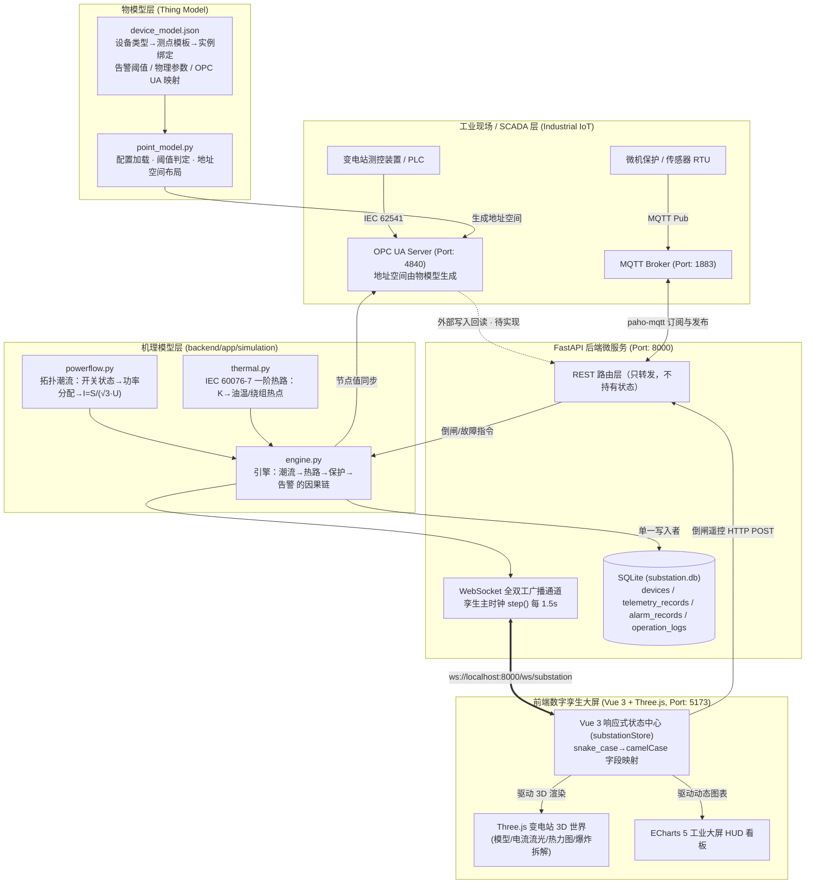

# 变电站数字孪生 IIoT 全链路架构指南 (FastAPI + OPC UA + MQTT + 物模型 + Three.js)

> 机理模型细节见 [`digital-twin-model-layer.md`](./digital-twin-model-layer.md)

## 1. 总体架构拓扑 (Architecture Diagram)



---

## 2. 核心技术组件详解

### 2.1 物模型层 (`backend/app/domain/`)
- **配置文件**：`device_model.json`，包含站点参数、设备类型模板（测点/OPC UA 映射/物理参数）、设备实例与拓扑绑定。
- **载荷**：新增设备、增删测点、调整告警阈值只改配置，不改代码。
- **自描述接口**：`GET /api/model` 直接返回完整物模型，前端可据此动态渲染测点面板。
- **告警判定**：每个测点带 `warning`/`danger` 阈值与 `direction`（`high` 越高越危险，`low` 如 SF6 气压越低越危险）。

### 2.2 机理模型层 (`backend/app/simulation/`)
- **`powerflow.py`**：三条硬约束——功率守恒、电流由功率导出、失电即零流。母联只输送两侧不平衡功率。
- **`thermal.py`**：IEC 60076-7 一阶热路模型，油温与绕组热点温度由负载率和冷却能力演化；用指数积分解而非欧拉法。
- **`engine.py`**：唯一状态源 `TwinEngine`，方法有 `step()` / `set_breaker()` / `inject_fault()` / `clear_fault()` / `snapshot()`。
- **时间压缩**：`time_compression = 300`，把真实 τ_oil=9000s 压到 30s，配置化声明而非隐藏魔法。

### 2.3 工业级 OPC UA 服务端 (`backend/app/opcua/server.py`)
- **端点**：`opc.tcp://0.0.0.0:4840/freeopcua/server/`，命名空间 `http://substation220kv.digitaltwin.org`
- **地址空间**：由物模型生成，共 **17 个节点 / 5 个设备文件夹**（`Transformer_1`、`Transformer_2`、`GIS_Breaker_201`、`GIS_Breaker_202`、`GIS_Breaker_101`）
- **可写节点**：三台断路器的 `BreakerPosition`，支持远程遥控与防误闭锁
- **写入方向**：孪生快照按物模型映射写入节点值（引擎 → 节点，已实现）
- **回读方向（待实现）**：外部客户端直接改写节点值目前**不会**回流到孪生引擎（且会被下一次同步覆盖），
  需要补节点轮询比对与写入仲裁。真正入站的控制通路是 MQTT 控制主题

### 2.4 MQTT 物联网网关客户端 (`backend/app/mqtt/client.py`)
- **主题规范 (Topics)**：
  - **遥测上报**：`substation/220kv/telemetry`（QoS 0，全站有功、无功、频率、电压）
  - **遥控下发**：`substation/220kv/control`（QoS 1，如 `{"device_id": "gis-201", "action": "open"}`，直接驱动孪生引擎）
  - **告警上报**：`substation/220kv/alarms`（QoS 1，由物模型阈值越限自动触发）

### 2.5 数据库模型与持久化 (`backend/app/models.py`)
- **ORM**：SQLAlchemy 2.0 Async（驱动 `aiosqlite`），数据库文件 `substation.db`
  ——路径为**绝对路径**并锚定工程根目录（可用 `DATABASE_URL` 覆盖）。
  原先写成 `./substation.db` 会随进程工作目录漂移，从不同目录启动会各自生成一个库，
  表现为"历史曲线和告警突然查不到"的假故障。
- **核心数据表**：
  1. `devices`：设备台账（种子数据来自物模型）
  2. `telemetry_records`：时序采样（每 10 步落库一次），含 `trans1_hot_spot`、`trans2_oil_temp/hot_spot`、`gis201_current`、`station_load_rate`、`shed_mva`
  3. `alarm_records`：告警记录（id 由引擎生成，避免重复落库）
  4. `operation_logs`：倒闸/保护动作/故障注入审计流水
- **平滑升级**：`database.init_schema()` 用 `PRAGMA table_info` 检查后 `ALTER TABLE ADD COLUMN`，幂等补列

### 2.6 写入纪律（重要）
只有 `ws.telemetry_background_publisher`（孪生主时钟）向数据库写数据，REST 路由只修改引擎状态。
这样避免了"路由写一次、推流又写一次"的重复记录，时序列也天然对齐同一个时间步。

### 2.7 WebSocket 全双工通道 (`backend/app/routers/ws.py`)
- **连接地址**：`ws://localhost:8000/ws/substation`
- **报文协议**：
  - 握手快照：`{"type": "INITIAL_SNAPSHOT", "telemetry": {...}, "devices": {...}, "model": {...}}`
  - 周期更新：`{"type": "TELEMETRY_UPDATE", "telemetry": {...}, "devices": {...}, "model": {...}}`
  - 客户端可发 `{"action": "PING"}` / `{"action": "GET_SNAPSHOT"}`
- **`model` 段**：`step`、`converged`、`time_compression`、`in_service_transformers`、`de_energized`、`active_faults`、`thermal_steady_state`
- **注意**：后端推的是物模型字段名（snake_case），前端状态是 camelCase，
  `substationStore.js` 里的 `TELEMETRY_FIELD_MAP` / `DEVICE_FIELD_MAP` 是两侧唯一契约点。

---

## 3. 接口清单

| 方法 | 路径 | 说明 |
| :--- | :--- | :--- |
| GET | `/api/devices` | 设备台账 + 实时孪生状态 |
| GET | `/api/devices/{id}` | 单台设备详细测点 |
| GET | `/api/telemetry/latest` | 全站遥测快照（与推流同源） |
| GET | `/api/telemetry/model` | **模型运行状态**：步数、收敛判据、在运设备、热稳态 |
| GET | `/api/telemetry/history` | 历史时序曲线（ECharts 回放） |
| GET | `/api/model` | **物模型自描述** |
| POST | `/api/control/breaker` | 倒闸遥控（SF6 气压低于闭锁值返回 409） |
| POST | `/api/control/fault/inject` | 故障注入（改变模型边界条件） |
| POST | `/api/control/fault/reset` | 全站事故复归 |
| GET | `/api/alarms` | 告警列表（引擎实时 + 数据库历史，按 id 去重） |
| POST | `/api/alarms/{id}/ack` | 告警确认 |
| GET | `/api/logs` | 操作票审计流水 |
| WS | `/ws/substation` | 实时推流 |

---

## 4. 服务快速启动与验证方式

### 4.1 启动后端服务
```bash
cd /Users/xiongtianyu/Desktop/DT
backend/venv/bin/python backend/run.py
```
- Swagger 交互文档：[`http://localhost:8000/docs`](http://localhost:8000/docs)
- 物模型：[`http://localhost:8000/api/model`](http://localhost:8000/api/model)
- 模型运行状态：[`http://localhost:8000/api/telemetry/model`](http://localhost:8000/api/telemetry/model)

### 4.2 启动前端数字孪生大屏
```bash
npm run dev
```
- 浏览器打开 [`http://localhost:5173/`](http://localhost:5173/)
- 顶部应显示绿色 `● FastAPI + OPC UA + MQTT: 实时联动`，以及靛蓝色**模型已收敛 · step N**

### 4.3 运行模型层测试
```bash
backend/venv/bin/python -m unittest discover -s backend/tests -t backend -v
```
51 个用例，覆盖物理一致性、热路解析解、潮流约束、保护逻辑、SF6 闭锁、告警边沿触发与复归。

### 4.4 验证全链路倒闸遥控联动（实测数值）
1. 打开网页 `http://localhost:5173/`。
2. 右侧控制台点击 **"220kV GIS 202 遥控分闸"**。
3. **联动链路与预期结果**：
   - 前端 `POST /api/control/breaker` → 引擎改变拓扑
   - **潮流重算**：II 段母线失电 → trans-2 退出（电流归 0）→ 其负荷转移给 trans-1
   - trans-1 负载率 **76.1% → 151.9%**（过载），全站供电仍维持约 364 MVA
   - 引擎写入 OPC UA 可写节点 `BreakerPosition = False`
   - MQTT 发布变位报文；`operation_logs` 落入操作票
   - WebSocket 广播新快照 → 3D 场景电流粒子流即时停止；顶部"带电母线"少一段

### 4.5 验证故障由模型演化（而不是赋值）
| 注入故障 | 边界条件改变 | 模型演化出的后果 |
| :--- | :--- | :--- |
| `trans_overheat` | 冷却器可用率 → 0.5 | 油温按一阶热路爬升，**58.2℃ → 91.3℃**，31 步后越过 85℃ 触发危险告警 |
| `sf6_leak` | 气压按 0.008 MPa/步 衰减 | 约 16 步跌破 0.45MPa → 危险告警 → **合闸被闭锁（HTTP 409）** |
| `overload_trip` | 出线负荷 × 2.2 | 出线电流 1487A 越过 1000A 定值 → 延时 3 个周期出口跳闸 → 甩负荷约 135 MVA，主变负载率回落到 47.8% |
